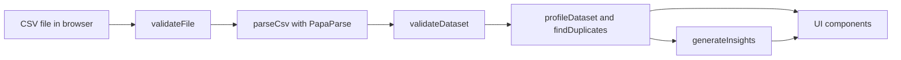

# Datatistics

A privacy-first CSV analysis tool for students. Choose a CSV file and get a preview, column types, statistics, data-quality checks, charts and plain-language findings. 

**The file is processed in your browser and is never uploaded.**

**Live demo:** https://datatistics.vercel.app


## Features (implemented)

- CSV validation (file type, size limit of 5 MB, empty files, missing header)
- Preview of the first 10 rows
- Column type detection: number, boolean, date (YYYY-MM-DD), text
- Missing values and duplicate rows
- Mean, median, min, max and sample standard deviation for numeric columns
- Most common values for text and category-like columns
- Interactive charts: histogram or bar chart, selectable per column
- Plain-language findings (missing data, duplicates, row-number and ID-like columns, 0/1 columns, possible skew)
- Warnings when a file's rows do not match its header, so misaligned data is not analyzed silently
- "Try sample data" button with a synthetic dataset

## Privacy

Parsing and analysis run entirely in the browser of the user. There is no backend, database or account. The app makes no network request with your data. (Chart.js and PapaParse are bundled into the site.)

## Tech stack

HTML, CSS, TypeScript, Vite, PapaParse (CSV parsing), Chart.js (charts), deployed on Vercel.

## Architecture



- `src/features/`: pure logic (parsing, validation, analysis, insights, histogram). No page access.
- `src/components/`: code that draws results on the page.
- `src/utils/`: small shared helpers.
- `src/main.ts`: connects the pieces.

## Run locally

```bash
git clone https://github.com/<username>/datatistics.git
cd datatistics
npm install
npm run dev
```

Build for production: `npm run build`.

## Known limitations

- Prototype.
- Files over 5 MB are rejected. Only `.csv` files are supported.
- Numbers must be plain (`1200`, not `1,200` or `1e3`). Dates must be `YYYY-MM-DD`.
- Missing values are empty cells and `NA`, `N/A`, `NaN`, `null`.
- Duplicate detection is case-sensitive.
- A column counts as numeric only if every non-missing value is numeric.
- Category-like detection (10 or fewer distinct numeric values) is a heuristic.

## Sample data

`public/samples/student-survey.csv` is synthetic data invented for this project. It is not a real student data.

## AI assistance and credits

Claude by Anthropic was used as an assistant during development: explaining concepts, generating test files, suggesting code and helping debug.

 Libraries: [PapaParse](https://www.papaparse.com/), [Chart.js](https://www.chartjs.org/), [Vite](https://vite.dev/).
